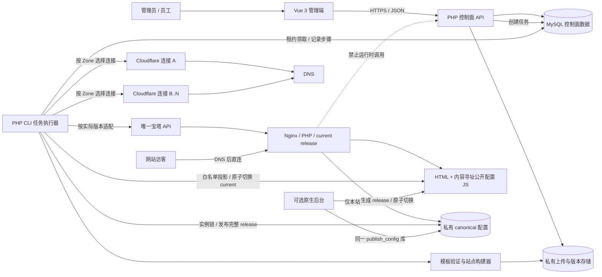
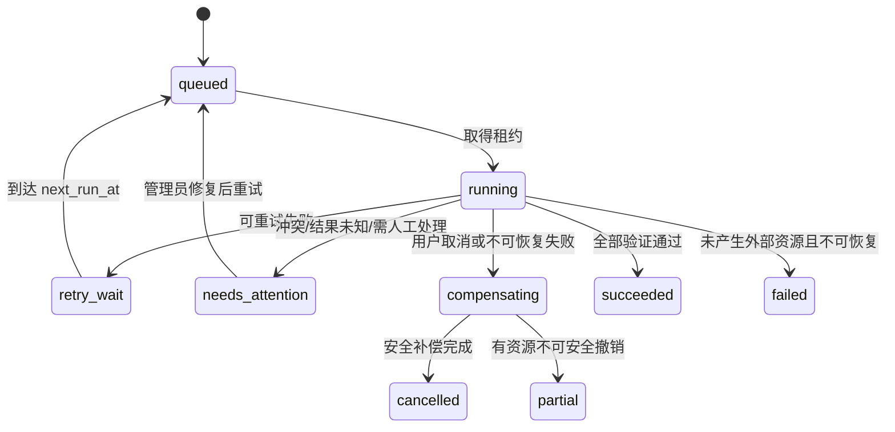

# LandingOps 技术架构

## 1. 架构原则

1. **控制面与运行面硬隔离**：LandingOps 只在创建、发布或显式配置更新时写入站点；访客请求不经过 LandingOps。
2. **单宝塔、多 Cloudflare 连接**：全局仅一条活动宝塔配置；Zone 各自绑定一个 Cloudflare 连接。
3. **外部系统默认只读保护**：发现既有 DNS 或宝塔站点时先阻止；只有本任务新建并记录所有权的资源可补偿删除。
4. **不可变输入、可恢复任务**：模板版本、备用页版本和组件版本不可原位替换；任务按持久化步骤恢复。
5. **站点本地配置为运行时真相**：数据库保存发布记录和期望状态，但站点请求只读本地配置。

## 2. 组件与职责

| 组件 | 职责 | 不负责 |
| --- | --- | --- |
| Vue 3 + Vite 管理端 | 表单、任务状态、权限范围内的资源操作 | 安全授权、直接持有第三方凭据 |
| PHP API | 认证授权、业务校验、事务、契约、审计 | 承载访客页面流量 |
| MySQL | 控制面元数据、任务、配置版本、审计 | 已部署站点运行时配置查询 |
| PHP CLI 任务执行器 | 领取任务、执行步骤、重试、补偿、验证 | 常驻独立微服务或第二套网站运行服务 |
| 宝塔适配器 | 封装实际版本支持的站点/SSL等操作 | 假定未经联调的端点存在 |
| Cloudflare 适配器 | Zone/记录查询与受控创建 | 覆盖未知或非本系统记录 |
| 模板验证/构建器 | 安全解压、LTS 校验、生成实例文件 | 生成截图或在线预览 |
| 站点目录 | 完整内容、本地配置、可选后台 | 请求 LandingOps API/DB |

## 3. 总体架构图



虚线表示被架构规则禁止的依赖，不是调用路径。

## 4. 控制流与数据流

### 4.1 创建与部署

1. API 进行身份、团队、模板授权、主域名授权和 schema 校验。
2. 一个数据库事务创建实例草稿、唯一 FQDN 预留、配置期望版本、部署任务和步骤定义。
3. 执行器以数据库租约领取任务。V1 不引入 Redis/RabbitMQ；MySQL `jobs` 表 + `SELECT ... FOR UPDATE SKIP LOCKED`（需确认 MySQL 版本）足以承载轻量任务。
4. 执行器在调用外部系统前后写步骤状态和幂等证据。外部调用超时视为“结果未知”，必须先查询核验，不能盲目重放创建。
5. 文件构建在实例私有暂存区完成；canonical 配置按 manifest 白名单生成无敏感信息的内容寻址前台 JS，HTML 与 JS 在同一不可变 release 中校验。
6. 通过同文件系统的临时符号链接/指针原子切换 `current`；活动 release 内不原位覆盖文件。宝塔若生成默认根目录，必须先识别并隔离已知引导文件，发现未知内容立即阻止。
7. DNS/SSL/HTTPS 验证成功后实例激活。控制面只保存状态和审计，退出访客链路。

### 4.2 多 Cloudflare 路由

`instance -> primary_domain -> zone -> cloudflare_connection` 是唯一选路链。用户不能在请求中任意指定连接 ID；后端从获授权主域名解析连接。连接停用时阻止新部署，不影响既有站点继续解析。

相同规范化 Zone 名全局唯一，避免同名 Zone 从不同账号重复导入后选错连接。若业务确需同名 Zone 多账号迁移，应先设计显式迁移状态，不在 V1 静默放开。

### 4.3 配置双写协调

- 站点本地配置包含 `schema_version`、单调递增 `revision`、`content_hash`、`updated_at` 和 `updated_by`。
- LandingOps 和原生后台写入时都必须提交 `expected_revision`，在站点侧取得文件锁，重新读取并比较。
- LandingOps 与原生后台调用相同的 `publish_config` 库：在实例锁内写私有 canonical 配置、按公开字段白名单生成 `assets/landingops.config.r<revision>.<hash12>.js`、更新 HTML 精确占位符，并校验完整 release。
- 新 release 在同文件系统写入并 `fsync`/关闭，校验 manifest 后以临时 `current` 链接原子重命名切换；活动 release 内禁止原位修改。HTML 使用 `no-cache`，内容寻址 JS 使用一年 `immutable` 缓存。
- LandingOps 数据库只在站点写成功后把配置版本记为 `applied`。超时后先读取本地版本/哈希判定是否成功。
- 版本冲突返回当前 revision 和安全的差异摘要，由用户重新加载；禁止“数据库旧值覆盖站点新值”。
- 主动恢复历史内容会复制旧 payload 并创建更高 revision；切换前失败不改变 active revision，切换后健康检查失败可原子回到上一已知良好 release。

### 4.4 模板上传与授权边界

Phase 1E 的模板 ZIP 由控制面 PHP 接收，但先复制到 Web Root 外的私有 `intake`，使用 `0700/0600` 权限且不解压、不 include、不交给 PHP-FPM 执行。Phase 1B 的验证器在私有 SHA-256 快照上检查大小、条目数、路径、链接、危险文件、Manifest、Schema、能力与敏感内容。只有验证成功后才把同一快照复制为不可变版本文件，并在一个数据库事务中写入模板版本、默认团队授权与审计；事务失败会删除新文件，验证失败会清理 intake 且不创建有效版本。

模板可见性和新实例选用权只由服务端查询 `template_grants.status=active` 决定。模板归属、上传者或客户端提交的团队 ID 都不能绕过撤销。总管理员可查看全部版本并授权、撤销或再次授权；撤销不修改已经引用该版本的实例。

### 4.5 Cloudflare 连接与域名登记边界

Phase 1F 只在控制面登记多条 Cloudflare Connection、其 Zone、主域名及团队授权，不加载 Cloudflare SDK，也不发起网络请求。Token 使用 AES-256-GCM、随机 nonce 和记录 ID AAD 进行认证加密；活动密钥版本与密钥环来自进程环境，数据库仅保存密文和版本，API/日志/审计不返回明文或密文。轮换 Token 后连接重新进入 `unverified`。

新连接和人工登记 Zone 固定为 `unverified`；本阶段 API 不能把它们改为 `active`。资源链严格由数据库解析为 `primary_domain -> zone -> connection`，客户端不能以 connection ID 绕过 Zone。团队授权只控制未来选用权；撤销或停用不删除 DNS，也不改变已有实例。员工只有在连接、Zone、主域名均为 active 且团队 grant 有效时才看到可用资源。

## 5. 任务状态机



步骤建议：`preflight` → `verify_reservation` → `inspect_dns` → `inspect_bt_sites` → `create_dns` → `create_bt_site` → `publish_files` → `apply_admin_guard` → `request_ssl` → `enable_https` → `verify` → `finalize`。FQDN 预留已在提交事务中创建，此步骤只复核其归属与租期；具体外部 API 名在联调后确定。

每个步骤保存：状态、幂等键、输入摘要、外部资源 ID、是否由本任务创建、尝试次数、时间、脱敏错误。执行器崩溃后，租约过期的任务可被重新领取并从核验开始。

## 6. 队列决策

V1 采用 **MySQL 持久化任务队列 + PHP CLI worker**：

- 工作量较小，已有 PHP/MySQL 运行环境；减少 Redis/RabbitMQ 的运维面。
- 宝塔计划任务或 systemd/supervisor 只负责保持 CLI worker 运行，不能把长任务放在 Web 请求里。
- 领取使用短事务和租约；心跳续租；并发量可配置，默认低并发以保护宝塔和第三方限额。
- 若目标 MySQL 不支持 `SKIP LOCKED`，Phase 1B 采用带条件的原子 `UPDATE` 领取方案，不能依赖未经确认的语法。
- 只有在量级或可靠性证据证明不足时，后续 ADR 才引入专用消息队列。

## 7. 文件与进程边界

- 控制面应用配置、上传物、解压临时目录、供应商组件和备用页版本均在 Web 根目录之外；实例目录由配置的站点根父目录派生，路径不接受用户输入。
- ZIP 解压拒绝绝对路径、`..`、符号链接/硬链接、设备文件、超限文件数/解压大小和扩展名策略违规。
- 上传暂存目录挂载/配置为不可执行，基准目录 `0700`、文件 `0600`，再以命名 ACL 仅授予 Web 用户 intake 的 `write+traverse`、worker 的 `read/write/traverse`；Web 用户没有目录列举权，也不能执行或读取已验证模板库。worker 扫描后以只读内容哈希对象归档。
- 控制面 Web、CLI worker 和每个站点 PHP-FPM 使用不同 Unix 身份。Web 用户不能写站点；worker 通过实例级 ACL 只写受管暂存/release/current；站点用户不能遍历控制面、模板库、其他实例或其他团队目录。
- 每个含 PHP/原生后台的实例使用独立 PHP-FPM pool/Unix 用户；`open_basedir` 至少限定本站 releases、staging 与 tmp。若目标宝塔无法提供等价隔离，V1 只允许静态模板，PHP/原生后台不得启用。
- 每个 release 同时包含 `public/` 和非 Web 根的 `private/`；`current` 一次切换同时激活 HTML/公开 JS 与 canonical 配置。`public` 建议 `0755/0644`，`private` 默认 `0750/0640`。原生后台只可在本站创建 staging release并切换本站 current，不能原位修改 active release。
- 平台密钥目录建议 `0750/0640` 且站点用户无遍历权；Nginx root 固定为 `current/public`，从路径层面排除 `current/private`。
- 第三方 Token 解密仅发生在适配器调用期，不传到前端、站点进程、任务输入 JSON 或普通日志。
- 供应商 `index.php/core.php` 与模板原始 `index.html` 分版本存储；构建器按合法集成清单装配，默认不修改供应商核心逻辑。

建议生产目录边界（实际绝对路径待宝塔环境确认）：

```text
control-plane/                 # Web 可读应用；站点用户不可遍历
private-secrets/               # Web/worker 所需最小凭据；站点用户不可访问
uploads/intake/                # Web 只写、worker 读写；noexec
template-store/                # worker 只读；Web/站点不可访问
instances/<instance-key>/
├── releases/<release-id>/
│   ├── public/                # HTML、资源、公开配置 JS
│   ├── private/               # canonical 配置/本站认证，不是 Web root
│   └── release-manifest.json  # 两侧内容的版本与哈希对应关系
├── current -> releases/...    # worker 原子切换
├── staging/                   # worker/本站发布库的临时 release
└── tmp/                       # 本站临时目录，无跨实例权限
```

不能只依赖 `open_basedir`：Unix 所有者、组/ACL、目录遍历权和独立 FPM pool 是最小隔离；容器可作为加强项但不是 V1 前提。

## 8. 故障隔离

| 故障 | 预期影响 | 隔离措施 |
| --- | --- | --- |
| LandingOps API/DB/worker 停机 | 无法创建/更新；任务暂停 | 已部署站点只读本地文件，继续服务 |
| 某 Cloudflare 连接失效 | 对应 Zone 的新任务失败/等待 | 其他连接和既有 DNS 不受影响 |
| 宝塔 API 不可用 | 新部署/证书操作暂停 | Nginx/PHP 现有站点不依赖 API 可用性 |
| 配置/release 写入中断 | 本次更新失败 | `current` 不变，旧 release 的公开与私有配置仍配套可读 |
| 批量中一行失败 | 单行失败 | 每行独立事务性任务，其他行继续 |
| 任务执行器崩溃 | 当前步骤结果可能未知 | 租约恢复；先查询外部状态再重试 |

此处仅保证架构上不依赖 LandingOps，不承诺宝塔、Nginx、PHP、DNS 或第三方网络本身永远可用。

## 9. 安全边界

- API 后端执行会话认证、CSRF/同源保护（依认证方式确定）、资源级授权、速率限制和审计。
- Cloudflare Token 应按连接最小化到所需 Zone 权限；宝塔 API 来源限制及签名方式待版本联调。
- 密钥使用应用主密钥加密存储，显示时仅给末尾提示；主密钥不放数据库和仓库。
- 原生后台密码使用现代密码哈希，仅在站点本地保存哈希；LandingOps 不可回显明文。
- 管理后台关闭时，由 Nginx `deny/return 404` 或不发布入口阻断 `/admin`；不得只隐藏前端链接。
- URL 配置需协议白名单并防止生成危险 scheme；HTML/JSON 输出上下文正确转义。
- 审计记录追加写；高风险操作包含操作者、目标、前后摘要、关联任务和结果。

## 10. 部署拓扑

同一台服务器上使用宝塔已有 Nginx/PHP/MySQL：一个独立 LandingOps 管理站点承载控制面；CLI worker 与其共享应用代码和私有存储；各实例为独立宝塔站点与目录。逻辑隔离不要求容器或第二套 Web 服务，但不得让实例目录包含控制面凭据。

## 11. 待联调接口

- 宝塔实际版本、鉴权签名、站点列表/创建、PHP 版本绑定、SSL 申请、强制 HTTPS 与状态查询能力。
- Cloudflare 官方 API 的 Token 验证、Zone/记录分页、DNS 记录创建/查询/删除和限流响应。
- 服务器公网 IPv4/IPv6 策略、是否允许代理状态、通配符记录策略、证书签发与 DNS 传播窗口。
- MySQL 版本及并发领取语法；Windows 本地仅为开发目录，生产文件原子语义按 Linux 文件系统验证。

这些是联调项，不改变单宝塔、运行时独立、默认不覆盖等已定约束。

# Phase 1I：预演控制面

单站向导只负责收集资源 ID、子域名前缀和与固定模板版本匹配的 canonical 私有配置。浏览器不提交团队 ID、模板归属或资源状态。`DeploymentDryRunService` 在一次只读调用中重新装载主体、模板授权、主域名授权、Cloudflare 凭据上下文、实例与活动预留，并用数据库保存的 Schema 校验配置。

预演响应是可解释的计划而非状态机推进：不创建实例、不分配 revision、不持有域名、不创建 deployment job，也不调用任何外部写 API。未来正式提交必须在事务边界和外部幂等边界内重新执行相同检查；不得把历史 Dry Run 结果当作授权票据。

宝塔只读发现采用两级预算：清单最多 3 个分页请求/200 条记录，绑定域名详情最多 20 次。清单、分页或详情任一不完整即传播 `complete=false`，并将无已知冲突降级为 `unsupported`/`needs_attention`。此规则防止一个页面请求扇出为数百个面板调用。

# Phase 1J：表单与诊断可信边界

Schema 表单生成器采用“能完整解释才渲染”的策略：每个 `properties` 子节点必须生成字段或明确抛出 `config_form_schema_unsupported`。浏览器保留 `undefined`（省略）与 `null`（显式空值）的差异，只做可重复的标量转换；PHP 仍从不可变模板版本装载 Schema 进行最终验证。响应不包含提交值，公开投影继续由独立白名单投影器完成。

真实兼容性诊断与业务请求分离：运维 CLI 从进程环境读取一次性秘密，调用固定只读适配器并输出脱敏摘要。宝塔诊断沿用 3 页/200 站点及 20 详情预算；Cloudflare 诊断只执行 Token、单一明确 Zone 与相关精确 DNS 查询。任一“不完整”都只能产生 `needs_attention`/失败，诊断成功也不是写入许可。
