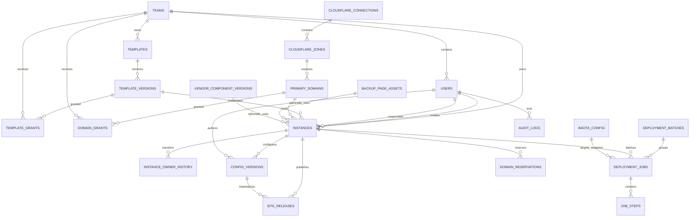

# LandingOps 数据库设计

## 1. 设计约定

- MySQL 8.x 为原目标；Phase 1C.1 已在宝塔实际 MariaDB 10.11.10 上联调，因此迁移兼容 MySQL 8 与 MariaDB 10.6+。字符集使用 `utf8mb4`、排序规则使用双方均支持的 `utf8mb4_unicode_ci`，时间以 UTC 存储。
- 主键建议使用 UUIDv7/ULID 的二进制或定长表示；示意图统一写 `uuid`。
- 业务软删除使用 `status/deleted_at`，高风险资源不做无审计硬删除。
- JSON 只保存结构灵活但有 schema 的数据；身份、授权、状态与关联均使用关系字段和外键。
- 密钥字段保存带算法/密钥版本的密文；日志、审计和任务输入不得复制明文。
- V1 只有一个活动宝塔配置，数据库约束和服务层同时保证。

## 2. ER 图

## 3. 组织与用户

### `teams`

`id`, `name`, `slug`, `status(active|disabled)`, `created_at`, `updated_at`。

- `UNIQUE(slug)`；slug 规范化后比较。

### `users`

`id`, `team_id NULL`, `email`, `password_hash`, `role(super_admin|team_admin|staff)`, `status`, `last_login_at`, `created_at`, `updated_at`。

- `UNIQUE(normalized_email)`。
- `super_admin` 的 `team_id` 可为空；其他角色必须非空（CHECK + 服务层校验）。
- 密码哈希永不进入审计 diff。

## 4. 模板

### `templates`

逻辑模板：`id`, `slug`, `name`, `description`, `owner_team_id NULL`, `created_by_user_id`, `status`, `created_at`, `updated_at`。

- `UNIQUE(slug)`。
- 总管理员上传可无团队归属；团队管理员上传必须等于操作者团队。
- 不设置截图、缩略图、效果图或预览 URL 字段。

### `template_versions`

`id`, `template_id`, `version`, `standard_version`, `zip_storage_key`, `zip_sha256`, `manifest_json`, `config_schema_json NULL`, `capability_tags_json`, `validation_status`, `validation_report_json`, `uploaded_by_user_id`, `published_at`, `created_at`。

- `UNIQUE(template_id, version)`、`UNIQUE(zip_sha256)` 可作为重复内容提示；同版本不同哈希必须拒绝。
- 发布后 ZIP、manifest 与 schema 不可原位修改。

### `template_grants`

`id`, `template_version_id`, `team_id`, `status(active|revoked)`, `granted_by_user_id`, `granted_at`, `revoked_by_user_id NULL`, `revoked_at NULL`。

- `UNIQUE(template_version_id, team_id)`；使用状态表达撤销。
- 团队上传后的默认授权只能在 grant 首次不存在时创建；若总管理员已将其置为 `revoked`，上传团队或模板所有权不能把它自动恢复为 `active`。
- 再次授权必须由总管理员显式执行，更新原唯一记录并清空撤销信息。撤销不级联修改 `instances`，已部署实例继续引用其不可变 `template_version_id`。

## 5. 单宝塔配置

### `baota_config`

`id`, `singleton_key`, `base_url`, `api_key_ciphertext`, `secret_key_version`, `expected_server_fingerprint NULL`, `status`, `last_verified_at NULL`, `created_by_user_id`, `updated_by_user_id`, `created_at`, `updated_at`。

- `singleton_key` 固定为 `1`，`UNIQUE(singleton_key)`，并以 CHECK 限定。这是“一台宝塔”的数据库边界。
- 不出现 `servers`、`server_pool_id`、权重或自动选择字段。
- API Key 只存密文；`base_url` 仅允许管理员配置并防 SSRF，实际值不写示例。

## 6. Cloudflare 与主域名

### `cloudflare_connections`

`id`, `label`, `account_external_id NULL`, `token_ciphertext`, `secret_key_version`, `token_hint`, `status`, `last_verified_at NULL`, `created_by_user_id`, `created_at`, `updated_at`。

- `label` 唯一；`token_hint` 只保存不可用于认证的末尾提示。
- Phase 1F 使用 AES-256-GCM、随机 nonce 与记录 ID AAD；环境密钥环由 `secret_key_version` 选取，原始 Token 和密文均不得进入 API、日志或审计。
- Phase 1G 的 003 迁移将连接/Zone 的 `admin_state` 与 `verification_status` 分离，并增加乐观锁 `version`、脱敏验证结果及 Zone `cloudflare_status`。Token 轮换只重置验证状态，不能启用已停用资源。
- Phase 1G.1 的 004 迁移增加连接 `credential_context_version` 与 Zone `verified_credential_context_version`。旧 `status=active` 不再被当作可信验证证据；004 保守回填为 `unverified`。Token 或 Account ID 变更会在事务内递增上下文版本、失效全部关联 Zone 并递增其乐观锁版本，同时保持 `admin_state`。
- 不因连接停用删除 Zone、DNS 或实例。

### `cloudflare_zones`

`id`, `connection_id`, `external_zone_id`, `zone_name`, `normalized_zone_name`, `status`, `last_synced_at`, `created_at`, `updated_at`。

- `UNIQUE(connection_id, external_zone_id)`。
- `UNIQUE(normalized_zone_name)`：V1 阻止跨连接重复导入同名 Zone，防止错误选路。

### `primary_domains`

`id`, `zone_id`, `domain_name`, `normalized_domain_name`, `status`, `dns_policy_json`, `created_by_user_id`, `created_at`, `updated_at`。

- `UNIQUE(normalized_domain_name)`；必须是所属 Zone 本身或经确认的可管理子域边界。

### `domain_grants`

`id`, `primary_domain_id`, `team_id`, `status`, `granted_by_user_id`, `granted_at`, `revoked_at NULL`。

- `UNIQUE(primary_domain_id, team_id)`。

## 7. 实例、负责人和预留

### `instances`

`id`, `team_id`, `template_version_id`, `primary_domain_id`, `fqdn`, `normalized_fqdn`, `site_path_key`, `status`, `created_by_user_id`, `current_owner_user_id`, `native_admin_enabled`, `backup_page_asset_id NULL`, `vendor_component_version_id NULL`, `active_config_revision`, `active_release_id NULL`, `created_at`, `updated_at`, `archived_at NULL`。

- `UNIQUE(normalized_fqdn)`、`UNIQUE(site_path_key)`。
- 创建人不可更新；负责人必须为同团队启用用户（总管理员操作仍不能把负责人设成跨团队员工）。
- 固定模板版本；升级创建显式变更记录，不能改写历史。

### `instance_owner_history`

`id`, `instance_id`, `from_user_id NULL`, `to_user_id`, `changed_by_user_id`, `reason`, `created_at`。

- 追加写；与实例负责人更新在同一事务。

### `domain_reservations`

`id`, `normalized_fqdn`, `instance_id`, `job_id NULL`, `status(held|committed|released|expired)`, `lease_expires_at`, `created_at`, `updated_at`。

- 活动预留需要并发唯一。兼容迁移使用显式可空 `active_fqdn`：held/committed 时必须等于 `normalized_fqdn`，released/expired 时必须为 NULL；`CHECK + UNIQUE(active_fqdn)` 共同约束，服务层在同一事务更新状态与该键。
- `committed` 与活跃实例共存；任务只有确认安全后才能释放。

## 8. 配置版本

### `config_versions`

`id`, `instance_id`, `revision`, `schema_version`, `content_hash`, `public_hash`, `config_json`, `source(landingops|native_admin|reconciled|restore)`, `status(pending|applied|conflict|failed)`, `base_revision`, `restored_from_config_version_id NULL`, `created_by_user_id NULL`, `applied_at NULL`, `created_at`。

- `UNIQUE(instance_id, revision)`；`INDEX(instance_id, content_hash)` 为**非唯一索引**，允许同一历史内容在恢复时以更高 revision 再次发布。
- 同请求重复提交由 API `Idempotency-Key`、任务幂等键和 `base_revision + request_digest` 判定，而不是依赖内容 hash 唯一。普通无变化更新可由服务层返回当前版本；显式恢复即使内容相同，也必须创建新 revision 并设置 `restored_from_config_version_id`。
- `config_json` 不含原生后台密码哈希或其他密钥。
- `content_hash` 是私有 canonical payload 摘要；`public_hash` 是白名单前台投影摘要，二者用途不同且都不作为唯一键。
- `instances.active_config_revision/active_release_id` 与本地 `current` release 协调，不能在发布切换及健康检查成功前推进；循环外键可在迁移中把 `active_release_id` 设为可空并后加约束，或只由服务层核验。

### `site_releases`

`id`, `instance_id`, `config_version_id`, `release_no`, `release_path_key`, `manifest_hash`, `public_config_asset`, `public_hash`, `status(staged|active|known_good|failed|retained|purged)`, `previous_release_id NULL`, `activated_at NULL`, `health_checked_at NULL`, `failure_summary NULL`, `created_at`。

- `UNIQUE(instance_id, release_no)`、`UNIQUE(instance_id, release_path_key)`；`public_config_asset` 必须是相对内容寻址路径。
- 一个实例最多一个 `active` release。为兼容 MySQL 8 与 MariaDB 10.11，迁移使用显式可空 `active_instance_id`，以 `CHECK` 强制 active 时等于 `instance_id`、非 active 时为 NULL，再由唯一索引保证；服务层必须在同一事务更新状态与该键。`current` 指向与数据库状态不一致时先以本地 release manifest 核验并协调。
- release manifest 保存 HTML、公开 JS、私有 canonical 配置版本和文件哈希的对应关系，但不保存任何明文密钥。
- 切换前失败的 staged release 可隔离/清理；切换后健康检查失败记录为 failed 并恢复上一 known-good 指针，active config revision 不推进。

## 9. 部署批次、任务与步骤

### `deployment_batches`

`id`, `team_id`, `created_by_user_id`, `status`, `total_count`, `succeeded_count`, `failed_count`, `created_at`, `completed_at NULL`。

聚合计数可重算；不得作为单任务真相来源。

### `deployment_jobs`

`id`, `batch_id NULL`, `instance_id`, `baota_config_id`, `operation(deploy|config_publish|verify|repair)`, `status`, `idempotency_key`, `priority`, `attempt_count`, `max_attempts`, `lease_owner NULL`, `lease_expires_at NULL`, `next_run_at`, `requested_by_user_id`, `last_error_code NULL`, `last_error_summary NULL`, `created_at`, `started_at NULL`, `finished_at NULL`。

- `UNIQUE(idempotency_key)`；`INDEX(status, next_run_at, priority)`；`INDEX(lease_expires_at)`。
- `baota_config_id` 始终指向唯一配置，用于历史审计而非服务器选择。

### `job_steps`

`id`, `job_id`, `step_key`, `sequence_no`, `status`, `idempotency_key`, `attempt_count`, `input_digest`, `external_resource_type NULL`, `external_resource_id NULL`, `created_by_this_step`, `result_json NULL`, `error_code NULL`, `error_summary NULL`, `started_at NULL`, `finished_at NULL`, `updated_at`。

- `UNIQUE(job_id, step_key)`、`UNIQUE(idempotency_key)`。
- `result_json` 必须经过字段白名单和脱敏；`created_by_this_step` 是允许补偿删除的重要证据，但仍需二次核验。

## 10. 备用页、供应商组件与审计

### `backup_page_assets`

`id`, `version`, `original_filename`, `storage_key`, `sha256`, `size_bytes`, `status`, `uploaded_by_user_id`, `created_at`。

- `UNIQUE(version)`、`UNIQUE(sha256)`；版本不可变。
- 当前仓库参考文件哈希为 `7562582EC704307B339907CA6B149340845966744EBF698B3B8FDBE0E8114352`，但是否导入为资产需管理员在实现后显式操作。

### `vendor_component_versions`

`id`, `name`, `version`, `storage_key`, `sha256`, `php_constraint`, `compatibility_json`, `status`, `uploaded_by_user_id`, `created_at`。

- 文件保存在私有存储；若扫描到疑似密钥，阻止发布并要求安全迁移。不得把源码/密钥写入数据库 JSON 或日志。

### `audit_logs`

`id`, `actor_user_id NULL`, `actor_type(user|worker|native_admin|system)`, `team_id NULL`, `action`, `resource_type`, `resource_id`, `request_id`, `job_id NULL`, `before_digest NULL`, `after_digest NULL`, `metadata_json`, `ip_hash NULL`, `created_at`。

- `INDEX(resource_type, resource_id, created_at)`、`INDEX(actor_user_id, created_at)`、`INDEX(job_id)`。
- 追加写；配置只记安全 diff/摘要，不记 Token、密码、供应商密钥或完整敏感请求。

## 11. 跨表约束与事务

- 创建实例：授权校验后，在同一事务写实例、预留、初始配置、任务和审计。
- 转交：锁定实例，校验同团队，更新负责人并追加历史/审计。
- 任务领取：使用租约避免重复 worker；租约过期只代表可恢复，不代表上次外部调用失败。
- 删除模板授权、域名授权、连接或用户采用状态变更，不级联删除实例、任务或站点。
- 数据库外键用于防孤儿记录；涉及“同团队”“唯一活动配置”等跨行规则同时由服务层和事务锁保证。

## 12. 数据保留与恢复

- 模板 ZIP、组件和备用页按内容哈希验证并备份；生产保留期由管理员政策确认。
- 审计、部署任务和负责人历史不能因业务对象软删除而消失。
- 数据库备份恢复不等于站点配置回滚。恢复控制面后应先读取各站点本地 revision/hash 做协调，禁止批量下发数据库旧配置。
- V1 默认本地保留最近 10 个成功 release，且至少覆盖最近 30 天；只有同时超出数量与时间门槛、且不被 active/known-good/任务引用的 release 才可清理。数据库配置版本默认保留 180 天，具体值需按磁盘与合规要求确认。
- 历史恢复执行“复制旧 payload → 新 revision → 新 release”，`restored_from_config_version_id` 指回来源；绝不复用旧 revision，也不会触发内容 hash 唯一冲突。

## 13. Phase 1C 迁移实现

`database/migrations/001_v1_control_plane.sql` 是首个可执行 MySQL 8 / MariaDB 10.6+ 迁移，覆盖本文 V1 表：团队、用户、Session、模板/版本/授权、唯一宝塔配置、多个 Cloudflare Connection/Zone、主域名/授权、实例/负责人历史、配置版本/release、批次/任务/步骤、域名预留、备用页、供应商组件和审计。

`database/migrations/002_fix_active_key_null_constraints.sql` 保持 001 不变，修复 SQL 三值逻辑：active release 必须显式满足 `active_instance_id IS NOT NULL AND active_instance_id = instance_id`；held/committed 预留必须显式满足 `active_fqdn IS NOT NULL AND active_fqdn = normalized_fqdn`。原 UNIQUE 约束继续负责活动键并发唯一。002 在永久 DDL 前以临时 guard 汇总扫描两表；存在历史异常时直接失败，不自动改写记录。

迁移器具备以下约束：

- 只接受 PDO `mysql` 驱动，拒绝 SQLite 等替代驱动；所有 DDL 使用 `CREATE TABLE IF NOT EXISTS`。
- `schema_migrations` 保存文件版本与 SHA-256；已应用文件内容变化会失败，重复执行会跳过。
- 使用 MySQL `GET_LOCK` 串行化迁移。MySQL DDL 可能隐式提交，因此失败后依靠幂等 DDL 继续执行，而不是宣称整份迁移具有事务原子性。
- `baota_config.singleton_key` 同时具有 `UNIQUE` 和 `CHECK(singleton_key=1)`，数据库层禁止第二条宝塔配置。
- `config_versions(instance_id, content_hash)` 是普通索引而非唯一约束，恢复旧内容可分配新 revision。
- `auth_sessions` 只保存 Cookie/CSRF Token 的 SHA-256 二进制摘要；数据库初始化脚本不含默认账号、明文密码、密码哈希或真实第三方凭据。

真实 MySQL/MariaDB 的版本、DDL、外键、CHECK 和唯一约束必须通过 `tests/mysql-integration.php` 在专用 `landingops_test` 数据库复核。无真实数据库环境时只能执行 SQL 契约与服务层测试，不能声称已经验证数据库兼容性。

